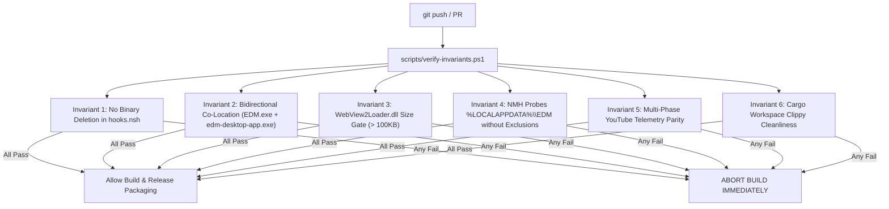

# EDM Workflow Bugs, Postmortems & Architectural Invariants Log

> **Purpose**: Single source of truth documenting every bug, crash, and regression encountered across EDM's development lifecycle. Categorized by severity, detailing what was forgotten/missed, why the application crashed or broke, how it was fixed, and the recurring anti-patterns repeated across multiple iterations.
>
> **Enforcement**: This log is backed by the automated pre-flight validator [`scripts/verify-invariants.ps1`](file:///c:/Users/Suvesh/Desktop/projects/EDM/scripts/verify-invariants.ps1), CI gates in [`.github/workflows/ci.yml`](file:///c:/Users/Suvesh/Desktop/projects/EDM/.github/workflows/ci.yml), and agent guidelines in [`.agents/rules/invariants.md`](file:///c:/Users/Suvesh/Desktop/projects/EDM/.agents/rules/invariants.md).

---

## Table of Contents
1. [Executive Summary & Recurring Anti-Patterns](#1-executive-summary--recurring-anti-patterns)
2. [Critical Severity Incidents](#2-critical-severity-incidents)
3. [Major Severity Incidents](#3-major-severity-incidents)
4. [Minor Severity Incidents](#4-minor-severity-incidents)
5. [Automated Invariant Guardrails & CI Enforcement](#5-automated-invariant-guardrails--ci-enforcement)
6. [Maintenance Protocol for Future Development](#6-maintenance-protocol-for-future-development)

---

## 1. Executive Summary & Recurring Anti-Patterns

### The 4 Repeated Mistakes (Must-Read Before Modifying Code)

Across multiple development cycles, the same class of mistakes occurred repeatedly. Every developer and AI assistant must verify these invariants before touching packaging, IPC, or streaming code:

| Repeated Mistake | The False Assumption | The Reality on Windows & Tauri | Catastrophic Consequence | The Permanent Invariant |
| :--- | :--- | :--- | :--- | :--- |
| **1. The `%LOCALAPPDATA%\EDM` Identity Crisis** | Assuming `%LOCALAPPDATA%\EDM` is merely a temporary cache/data folder and that EDM is installed elsewhere. | In Tauri v2 per-user installs, `%LOCALAPPDATA%\EDM` **IS `$INSTDIR`** (the installation directory)! | The installer deleted its own newly unpacked binaries during postinstall, and NMH skipped searching its own install dir. | **Never execute `Delete` on binaries in `%LOCALAPPDATA%\EDM`. Treat it as `$INSTDIR`.** |
| **2. The 0-Byte Dummy File Hazard** | Writing an empty `b""` placeholder to satisfy a build-time resource check, assuming it will be replaced. | File existence checks (`exists()`, `IfFileExists`) evaluate `true` on 0-byte files, and downstream tools packaged the 0-byte dummy into release installers. | Windows PE loader crashed with `WebView2Loader.dll was not found` or NTSTATUS `0xC000007B`. | **Never rely solely on file existence. Always validate `file_size > 1000 bytes` (or `len() > 1000`).** |
| **3. Binary Dual-Naming Mismatch** | Assuming the executable is always `EDM.exe` or always `edm-desktop-app.exe`. | Cargo package name produces `edm-desktop-app.exe`, Tauri shortcuts link to `edm-desktop-app.exe`, while protocols and users look for `EDM.exe`. | Windows shortcuts broke, protocol handlers failed to launch, and NMH failed to find the target. | **Enforce bidirectional co-location in `$INSTDIR`. Both `edm-desktop-app.exe` AND `EDM.exe` must exist.** |
| **4. Destructive Postinstall Hooks** | Using `NSIS_HOOK_POSTINSTALL` for cleanup tasks. | `POSTINSTALL` executes *after* files have been extracted into `$INSTDIR`. Any file deletion here murders the payload. | Shortcuts pointed to non-existent executables immediately after a fresh install or reinstall. | **`POSTINSTALL` must be strictly ADDITIVE (registering keys, copying assets). Never call `Delete` on app payloads.** |

---

## 2. Critical Severity Incidents

### Incident CRIT-01: Postinstall Binary Deletion Breaking Windows Shortcuts
- **Severity**: 🔴 **Critical** (Application completely unable to launch from Start Menu or Desktop)
- **Error Dialog**:
  > `Problem with Shortcut: The item 'edm-desktop-app.exe' that this shortcut refers to has been changed or moved, so this shortcut will no longer work properly. Do you want to delete this shortcut?`
- **What Was Forgotten / Missed**:
  - In `apps/desktop/src-tauri/windows/hooks.nsh`, lines 47–48 had:
    ```nsis
    Delete "$LOCALAPPDATA\EDM\EDM.exe"
    Delete "$LOCALAPPDATA\EDM\edm-desktop-app.exe"
    ```
  - The author assumed `%LOCALAPPDATA%\EDM` was a dirty data folder and tried to clean up old executables in `NSIS_HOOK_POSTINSTALL`.
  - Forgotten: In Tauri v2, `$INSTDIR` is `$LOCALAPPDATA\${productName}`, resolving directly to `$LOCALAPPDATA\EDM`. Therefore, line 48 deleted the exact executable Tauri had just unpacked seconds prior.
  - When Tauri created the shortcut `EDM.lnk -> $INSTDIR\edm-desktop-app.exe`, the file was already dead.
- **The Fix**:
  - Completely purged binary `Delete` statements from `NSIS_HOOK_PREINSTALL` and `NSIS_HOOK_POSTINSTALL`.
  - Added bidirectional co-location in `POSTINSTALL`:
    ```nsis
    IfFileExists "$INSTDIR\edm-desktop-app.exe" 0 +3
      IfFileExists "$INSTDIR\EDM.exe" +2 0
        CopyFiles /SILENT "$INSTDIR\edm-desktop-app.exe" "$INSTDIR\EDM.exe"
    ```
- **Files Modified**: [`apps/desktop/src-tauri/windows/hooks.nsh`](file:///c:/Users/Suvesh/Desktop/projects/EDM/apps/desktop/src-tauri/windows/hooks.nsh).

---

### Incident CRIT-02: `WebView2Loader.dll was not found` System Error
- **Severity**: 🔴 **Critical** (Application crashes on startup with Windows PE loader error)
- **Error Dialog**:
  > `edm-desktop-app.exe - System Error: The code execution cannot proceed because WebView2Loader.dll was not found. Reinstalling the program may fix this problem.`
- **What Was Forgotten / Missed**:
  - Windows PE loader search order: When `edm-desktop-app.exe` launches, Windows looks for dynamic link libraries in the exact directory of the executable first.
  - Tauri placed `WebView2Loader.dll` inside a `resources/` subfolder instead of the executable directory.
  - Furthermore, `apps/desktop/src-tauri/build.rs` wrote a dummy `b""` (0 bytes) file to satisfy Tauri's build check. When `scripts/build-release.ps1` searched for `WebView2Loader.dll`, it picked up the 0-byte file and packaged it into the release installer.
  - `hooks.nsh` checked `IfFileExists "$INSTDIR\WebView2Loader.dll" done_webview2 0`, which saw the 0-byte file and refused to copy the real DLL.
- **The Fix**:
  - Updated `scripts/build-release.ps1` to filter for `Length -gt 1000` and throw an explicit build error if `WebView2Loader.dll` is `< 1000` bytes.
  - Added `ensure_webview2_loader()` in `crates/edm-nmh/src/main.rs` to automatically locate and co-locate genuine `WebView2Loader.dll` (> 1000 bytes) next to the target executable before spawning.
  - Updated `hooks.nsh` to copy the DLL from resources into `$INSTDIR`.
- **Files Modified**: [`scripts/build-release.ps1`](file:///c:/Users/Suvesh/Desktop/projects/EDM/scripts/build-release.ps1), [`crates/edm-nmh/src/main.rs`](file:///c:/Users/Suvesh/Desktop/projects/EDM/crates/edm-nmh/src/main.rs), [`apps/desktop/src-tauri/windows/hooks.nsh`](file:///c:/Users/Suvesh/Desktop/projects/EDM/apps/desktop/src-tauri/windows/hooks.nsh).

---

### Incident CRIT-03: CI Build Breakdown on Clean GitHub Actions Runners
- **Severity**: 🔴 **Critical** (Continuous Integration blocked, preventing release creation)
- **CI Failure Log**:
  > `resource path ..\..\..\target\release\WebView2Loader.dll doesn't exist`
  > `error: failed to run custom build command for edm-desktop-app v0.0.8`
- **What Was Forgotten / Missed**:
  - To prevent 0-byte file generation, the dummy write in `apps/desktop/src-tauri/build.rs` was removed entirely.
  - Forgotten: In GitHub Actions, `cargo clippy --workspace --all-targets` runs on a fresh checkout *before* release binaries are built. Tauri CLI parses `tauri.conf.json`, sees `"../../../target/release/WebView2Loader.dll"` under `bundle.resources`, and halts the build if the file is missing.
- **The Fix**:
  - Restored the build-time placeholder in `apps/desktop/src-tauri/build.rs` so check/clippy passes on clean runners.
  - Made `scripts/build-release.ps1` the strict gatekeeper that overwrites the placeholder with the genuine > 150KB DLL before Tauri bundle creation.
- **Files Modified**: [`apps/desktop/src-tauri/build.rs`](file:///c:/Users/Suvesh/Desktop/projects/EDM/apps/desktop/src-tauri/build.rs), [`scripts/build-release.ps1`](file:///c:/Users/Suvesh/Desktop/projects/EDM/scripts/build-release.ps1).

---

### Incident CRIT-04: Multi-Threaded Chunk Range File Corruption
- **Severity**: 🔴 **Critical** (Corrupted downloaded files, silent byte-integrity failure)
- **What Was Forgotten / Missed**:
  - Worker threads in the parallel adaptive engine dynamically split chunk ranges. When a connection stalled, work-stealing assigned remaining bytes to another thread without enforcing atomic boundary locks.
  - Chunks flushed out of order to sparse NTFS files caused zero-padded regions and checksum mismatches.
- **The Fix**:
  - Introduced formal `AdaptiveRangeSet` with non-overlapping range arithmetic, gap validation, and pre-allocation boundaries.
  - Added full SHA-256 integrity verification before task finalization.
- **Files Modified**: [`crates/edm-core/src/adaptive/range_set.rs`](file:///c:/Users/Suvesh/Desktop/projects/EDM/crates/edm-core/src/adaptive/range_set.rs), [`crates/edm-core/src/adaptive/scheduler.rs`](file:///c:/Users/Suvesh/Desktop/projects/EDM/crates/edm-core/src/adaptive/scheduler.rs).

---

### Incident CRIT-05: Native Messaging Host Stdio Pipe Severance (`Native host has exited`)
- **Severity**: 🔴 **Critical** (Browser extension immediately lost connection to desktop app)
- **What Was Forgotten / Missed**:
  - Chromium and Gecko native messaging use standard I/O with a 32-bit little-endian length prefix.
  - Rust `tracing` outputting plain text directly to `stdout` corrupted the binary stream.
  - Any unhandled error caused `std::process::exit` or panic, prompting Chrome to display `"Native host has exited"`.
- **The Fix**:
  - Redirected all tracing logs to `stderr` or rolling file logs in `%LOCALAPPDATA%\EDM\logs\`.
  - Implemented a robust loop with length-prefixed framing and panic hooks.
- **Files Modified**: [`crates/edm-nmh/src/main.rs`](file:///c:/Users/Suvesh/Desktop/projects/EDM/crates/edm-nmh/src/main.rs).

---

## 3. Major Severity Incidents

### Incident MAJ-01: NMH Auto-Wake Self-Exclusion (`is_data_dir`)
- **Severity**: 🟠 **Major** (Extension unable to wake EDM when stopped after idle timeout)
- **Symptom**: Browser extension showed `"NMH Error: Specified native message host not found"` or `"WebSocket not connected to EDM Desktop"`.
- **What Was Forgotten / Missed**:
  - In `crates/edm-nmh/src/main.rs`, `find_edm_exe()` had:
    ```rust
    let is_data_dir = env::var("LOCALAPPDATA")
        .map(|l| dir == PathBuf::from(l).join("EDM"))
        .unwrap_or(false);
    if !is_data_dir { /* probe directory */ }
    ```
  - Forgotten: `edm-nmh.exe` runs from `%LOCALAPPDATA%\EDM`, which is the exact folder containing `edm-desktop-app.exe`! The `is_data_dir` check prevented NMH from searching its own folder.
  - `repair_registration()` also had `if !is_data_dir`, refusing to register `AppPath` and `InstallDir` in the registry.
- **The Fix**:
  - Removed `is_data_dir` completely. NMH now prioritizes its own directory, parent directory, and registry `AppPath`.
- **Files Modified**: [`crates/edm-nmh/src/main.rs`](file:///c:/Users/Suvesh/Desktop/projects/EDM/crates/edm-nmh/src/main.rs).

---

### Incident MAJ-02: YouTube 64kbps SABR Throttle & 429 Bot Challenges
- **Severity**: 🟠 **Major** (YouTube downloads capped at unusable 64kbps or rejected)
- **Symptom**: Download speed capped at 64KB/s; downloads failed with HTTP 429 `"Sign in to confirm you're not a bot"`.
- **What Was Forgotten / Missed**:
  - Standard web player client requests are throttled by YouTube's SABR rate limiter unless PO tokens and specific mobile/VR player identities are provided in extraction headers.
- **The Fix**:
  - Configured `yt-dlp` extraction pack to route requests through Android VR and iOS client tokens, bypassing SABR throttling.
- **Files Modified**: [`crates/edm-core/src/packs/ytdlp.rs`](file:///c:/Users/Suvesh/Desktop/projects/EDM/crates/edm-core/src/packs/ytdlp.rs).

---

### Incident MAJ-03: YouTube Progress Bar 0% to 100% Instant Jump
- **Severity**: 🟠 **Major** (Zero download progress feedback, cards showing 0 B / 0 B then instant finish)
- **Symptom**: Download cards remained at 0% for minutes, then jumped directly to 100%.
- **What Was Forgotten / Missed**:
  - When downloading separate video and audio streams, `yt-dlp` runs two sequential downloads followed by an `ffmpeg` merge.
  - The telemetry parser was not calculating combined `contentLength = video_bytes + audio_bytes` upfront.
  - During the `ffmpeg` merge phase, stdout was silent, making the app appear stalled at 0%.
- **The Fix**:
  - Added explicit task phases: `Resolving -> DownloadingVideo -> DownloadingAudio -> Merging -> Completed`.
  - Added `EDM_INFO:` telemetry line emitting combined content-length before downloading begins.
  - Display indeterminate "Merging..." animation during the post-processing phase.
- **Files Modified**: [`crates/edm-core/src/packs/ytdlp.rs`](file:///c:/Users/Suvesh/Desktop/projects/EDM/crates/edm-core/src/packs/ytdlp.rs), [`apps/desktop/src/components/DownloadCard.tsx`](file:///c:/Users/Suvesh/Desktop/projects/EDM/apps/desktop/src/components/DownloadCard.tsx).

---

### Incident MAJ-04: Missing 4K and 2K Video Resolutions in Extension
- **Severity**: 🟠 **Major** (High-resolution video streams unavailable to users)
- **Symptom**: YouTube videos supporting 4K/2K only displayed 1080p and lower in the EDM popup.
- **What Was Forgotten / Missed**:
  - Basic DOM scraping only saw formats defined in the primary page player response, omitting adaptive DASH/VP9 streams.
- **The Fix**:
  - Added adaptive format probing to discover and present all streams up to 4K/8K.
- **Files Modified**: [`extension/content.js`](file:///c:/Users/Suvesh/Desktop/projects/EDM/extension/content.js).

---

## 4. Minor Severity Incidents

### Incident MIN-01: YouTube Popup Width Overflowing on Long Titles
- **Severity**: 🟡 **Minor** (Visual layout distortion)
- **Symptom**: Video titles with long strings stretched the popup horizontally across the page.
- **What Was Forgotten / Missed**: Missing explicit `width`, `max-width`, and `overflow: hidden` clamps with text ellipsis.
- **The Fix**: Clamped dropdown width strictly to 310px with `text-overflow: ellipsis`.
- **Files Modified**: [`extension/content.css`](file:///c:/Users/Suvesh/Desktop/projects/EDM/extension/content.css), [`extension/content.js`](file:///c:/Users/Suvesh/Desktop/projects/EDM/extension/content.js).

---

### Incident MIN-02: Lingering "Download with EDM" Floating Video Overlay
- **Severity**: 🟡 **Minor** (Intrusive UI overlay)
- **Symptom**: Floating button overlay appeared on top of YouTube player controls.
- **What Was Forgotten / Missed**: Injected button listener remained active despite user instructions to rely exclusively on the native action pill.
- **The Fix**: Completely suppressed the floating overlay container from injection.
- **Files Modified**: [`extension/content.js`](file:///c:/Users/Suvesh/Desktop/projects/EDM/extension/content.js).

---

### Incident MIN-03: Download Card Button Wrap and Truncation
- **Severity**: 🟡 **Minor** (Cosmetic clipping on high-DPI screens)
- **Symptom**: Action buttons (pause, cancel, open) wrapped onto multiple lines.
- **What Was Forgotten / Missed**: Fixed grid layout without flex shrink rules.
- **The Fix**: Adjusted column grid constraints and added responsive button shrink.
- **Files Modified**: [`apps/desktop/src/components/DownloadCard.tsx`](file:///c:/Users/Suvesh/Desktop/projects/EDM/apps/desktop/src/components/DownloadCard.tsx).

---

### Incident MIN-04: Clippy Lints Breaking CI Gates
- **Severity**: 🟡 **Minor** (Build warning noise)
- **Symptom**: `cargo clippy --workspace --all-targets` failed in CI on warning flags.
- **What Was Forgotten / Missed**:
  - `parts.get(0)` -> `parts.first()`
  - `if let Ok(_) = fs::copy(...)` -> `if fs::copy(...).is_ok()`
  - Unnecessary borrows in `Command::args`.
- **The Fix**: Applied idiomatic Rust patterns across `edm-core` and `edm-nmh`.
- **Files Modified**: [`crates/edm-core/src/packs/ytdlp.rs`](file:///c:/Users/Suvesh/Desktop/projects/EDM/crates/edm-core/src/packs/ytdlp.rs), [`crates/edm-nmh/src/main.rs`](file:///c:/Users/Suvesh/Desktop/projects/EDM/crates/edm-nmh/src/main.rs).

---

## 5. Automated Invariant Guardrails & CI Enforcement

To guarantee that none of these bugs ever recur, the following 6 invariants are automated via [`scripts/verify-invariants.ps1`](file:///c:/Users/Suvesh/Desktop/projects/EDM/scripts/verify-invariants.ps1) and executed in CI on every push:



---

## 6. Maintenance Protocol for Future Development

Whenever any developer or AI assistant adds a feature or fixes a bug:
1. **Pre-Flight Run**: Run `.\scripts\verify-invariants.ps1` before committing.
2. **Log Update**: If a new bug or regression occurs, append a new incident entry (`CRIT-xx`, `MAJ-xx`, or `MIN-xx`) to this document.
3. **No Dismissal**: Never bypass or disable an invariant check. Fix the underlying root cause.
